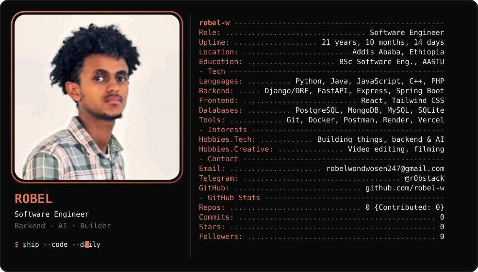

 

### 👋 Hi, I'm Robel

Software engineering student at **Addis Ababa Science and Technology University** and a backend developer who likes building real things: REST APIs, real-time systems, and AI-powered tools like RAG pipelines.

- 🔧 Currently into: Django REST, PostgreSQL + pgvector, WebSockets / Redis, RAG systems
- 🏆 6th place, 2026 ICPC Ethiopian Collegiate Programming Contest
- 🥈 2nd place, GDG AASTU Hackathon (Price Guard AI)
- 🎬 Off the keyboard: video editing and filming

### 📫 Reach me

<!-- Add your LinkedIn: replace YOUR-LINKEDIN-ID and remove the comment markers

-->

### 🛠 Tech

              

 

  

